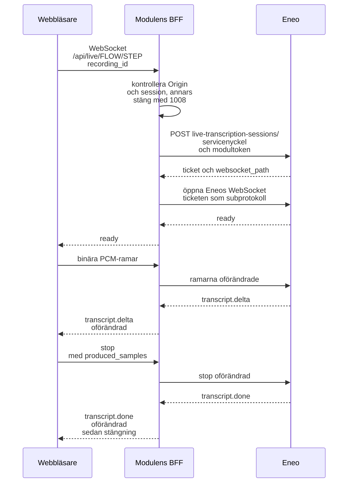

# Eneo-integration

## Så byggs en körning

Appen bygger körningen från Eneos publicerade flödeskontrakt:

1. `GET /api/v1/flows/{flowId}/run-contract/` hämtas innan användaren kör flödet.
2. Ljudsteget väljs från `steps_requiring_input`.
3. Filstorlek och MIME-typ valideras mot stegets `max_file_size_bytes` och `accepted_mimetypes`.
4. Ljud laddas upp till steg-scopade runtime-endpointen: `POST /api/v1/flows/{flowId}/steps/{stepId}/runtime-files/`.
5. Körningen startas först efter lyckad upload och skickar filen så här:

```json
{
  "expected_flow_version": 3,
  "step_inputs": {
    "step-id": {
      "file_ids": ["uploaded-file-id"]
    }
  }
}
```

Uppladdning och start går genom `frontend/lib/submit-run.ts`, som provar om vid tillfälliga fel och startar körningen med samma idempotensnyckel vid varje försök: [Inspelaren](recording.md#uppladdning-och-nya-försök).

Formulärets värden skickas som `input_payload_json`. Ett formulärfält kan i Eneos flödesbyggare få rollen `run_label` (ett textfält, "Namnge körningen efter fältet") eller `run_date` (ett datumfält). Eneo sätter då körningens `run_label` och `run_date` från fälten när körningen skapas, och dokumenten den skapar heter efter dem: `Styrelsemöte 2026-09-22.docx` i stället för flödets namn och startdagen. Listan över tidigare körningar (`GET …/runs/?mine=true`) har båda, och appen visar körningen med namn och datum utan att läsa varje körnings detaljer. Appen skickar själv ingen `run_label`.

Webbläsaren anropar alltid modulens `/api/eneo/...`; vilka rutter som släpps igenom står i [API-referens](api-referens.md) och reglerna i [Backend](backend.md#tillåtelselistan-för-eneo-anrop).

## Granskning och talarmappning

Ett publicerat flöde kan ha steg med `review_policy` som pausar körningen i status `awaiting_review`. Appen följer körningen (`GET …/runs/{runId}/`, `frontend/lib/follow-run.ts`) och hämtar då den aktiva checkpointen. Talarmappning är en sådan checkpoint (`review_mode = "edit"`, stegtypen `output_mode = "speaker_mapping"`): användaren väljer en deltagare per talare i "Namnge talarna", och "Spara namnen" skickar mappningen som stegets output (`edited_value` är alltid stegets output i sig, aldrig payload-kuvertet). Sidans "Godkänn och fortsätt" anropar sedan `approve` och `resume` (med `Idempotency-Key`) och appen fortsätter följa körningen. Granskningen är ett byggalternativ och av i en publicerad image ([Drift](operations.md#miljövariabler)).

Anropen mot Eneo (alla via [tillåtelselistan](backend.md#tillåtelselistan-för-eneo-anrop)):

- `GET …/runs/{runId}/review-checkpoints/active/`, `PATCH …/review-checkpoints/{checkpointId}/` med `expected_checkpoint_revision`, och `POST …/approve/`, `…/reject/`, `…/resume/`.

### Spelaren och transkriberingen

Vyn spelar upp inspelningen med en transkribering som följer ljudet. Segmenten (talare, start och slut per replik) kommer från `GET …/runs/{runId}/steps/`, ordtiderna från `GET …/steps/{stepId}/transcript-words/` (404 betyder inga ordtider, och då markeras bara repliken). Ordtiderna kommer från flödets tjänst för ordtider och talare (Vemsa), också när flödet inte identifierar talare. Kunde tjänsten inte ta fram dem säger transkriberingens `word_timing` `{"status": "failed"}`, och vyn säger då att ett klick spelar från början av avsnittet, eftersom bara avsnittens tider finns. Ordet som sägs fylls i takt med talet, som i sångtexter, och orden före det i meningen behåller en ljusare ton; det ritas bildruta för bildruta utan att listan ritas om, och ljudet strömmas via modulens backend ([Backend](backend.md#filer-ut-ur-eneo)). Ett ord som ordtiderna anger med sannolikhet 0 kunde inte placeras i ljudet och sträcker sig över resten av sitt fönster; när ljudet spelas slutar det där nästa ord börjar, och en replik som det gjorde längre slutar med sina ord, så det tänds inte över orden efter det.

### Rättningar

Repliker kan rättas i spelaren och en replikgrupp kan byta talare. Rättningarna är icke-destruktiva: de sparas per ändring som ett komplett ersättningsset (`PATCH …/steps/{stepId}/transcript-corrections/`, schema 3, med `expected_revision` och transkriberingens hash), och Eneo viker in dem när granskningen godkänns. Originalet ändras aldrig, och en föråldrad hash, ett ogiltigt ankare eller en annan revision blir aldrig en lyckad överskrivning. Schemat och reglerna för teckenpositioner finns i `frontend/lib/transcript-corrections.ts` och dess tester. Efter en rättning av en färdig körning kan dokumentet göras om ur den granskade transkriberingen: `POST …/steps/{stepId}/transcript-regenerations/` skapar en ny körning, och källkörningen och dess filer ändras aldrig (`frontend/lib/regenerate.ts`).

När körningen är klar kan talarna namnges: "Namnge talare" i transkriberingens talarrad, eller "Byt namn på" i en repliks "Ändra talare". Namnen hör till samma rättningsset (`speaker_names`, etikett till namn) och skickas med varje sparning, bara för transkriberingens etiketter och de talare som talarbytena ger. Ett namn ersätter namnet från ett namngivningssteg, `null` tar bort det (talaren heter "Talare N" igen) och en etikett utan post behåller stegets namn. Samma regel gäller i spelaren, i texten som kopieras och laddas ner och när dokumentet görs om (`effectiveSpeakerNames` i `frontend/lib/transcript-corrections.ts`). Eneo ändrar namnen bara på en körning som är klar, och ett namn är en rad med högst 120 tecken. Namnen syns i transkriberingen direkt; dokumentet får dem när det görs om, och ett resultat som redan har skickats vidare ändras inte.

## Live-text (Strömma)

Strömma visar texten medan användaren spelar in. Flödets modell för direktinspelning skriver det strömmade ljudet, eller transkriberingsmodellen när den strömmar och flödet inte har valt någon annan. Inspelningen laddas upp och flödet körs som i Spela in, med `streamed: true` i ljudstegets indata vad som än hände med live-sessionen: också när den inte kom igång, när dess sista text inte kom i tid, när texten inte kunde sparas med inspelningen och när inspelningen skickas efter en omladdning (`frontend/lib/submit-run.ts`). Spela in och Ladda upp skickar aldrig `streamed`. Har en enda live-session hört hela inspelningen skickas också sessionens `transcript_id` som `live_transcript_id`, och körningen använder sessionens text i stället för att transkribera ljudet en gång till, också när inspelningen är uppdelad i flera filer. Kan Eneo inte använda texten transkriberar flödets transkriberingsmodell ljudfilerna, och transkriberingssteget i `GET …/runs/{runId}/steps/` säger varför (`live_fallback_reason`), med vilken modell (`transcript_model_name`) och var texten kom ifrån (`transcript_origin`, `live` eller `batch`). Resultatet visar då "Livetexten kunde inte användas" med skälet och modellen, också när körningen misslyckades eller avbröts (`liveFallbackNotice` i `frontend/lib/run-result.ts`). Medan körningen pågår har den körningslåsta grafens nod för ljudsteget samma `live_fallback_reason` så snart steget har bestämt sig. Då läses stegen en gång för modellens namn (`frontend/lib/follow-run.ts`), och vyn för körningen visar samma besked under stegen. "Starta en ny körning" med en tidigare körnings ljud skickar `streamed` och `live_transcript_id` igen från stegets `runtime_input_streamed` och `runtime_input_live_transcript_id`, på samma sätt som `single_recording` från `runtime_input_single_recording`. Eneos `ready` säger med `keeps_transcript` om sessionens text kan bli körningens, vilket den kan när sessionen namnger inspelningen; är den `false` väntar körningen inte på sessionens sista text, och inget `transcript_id` kommer. Annars väntar webbläsaren på `transcript.done` så länge som `ready` säger i `finish_within_seconds`, räknat från att den skickar `stop`, och har ingen egen tidsgräns för det. Run-kontraktets `transcription.live` säger i förväg om flödets ljudsteg kan visa live-text. Ticketen hämtas och används bara av BFF:en, och ramarna och Eneos händelser går oförändrade åt vardera håll.



Webbläsaren öppnar en WebSocket till `/api/live/{flowId}/{stepId}?recording_id={id}` på modulens egen origin (`frontend/lib/live-transcriber.ts`) och skickar mono PCM16 LE i 16 kHz som binära ramar och till sist `{"type":"stop","produced_samples":n}`. En inspelning i flera delar skickar också `part_start_samples`: för varje del efter den första, var i samma räkning delen började (`frontend/components/flow/live-audio.ts`). Körningen får då alla delar i ordning med `single_recording`, `streamed` och `live_transcript_id`. Nekar Eneo ticketen, till exempel 409 `flow_live_transcription_unavailable`, får webbläsaren en enda `error`-händelse med Eneos `code` och sedan en normal stängning; når BFF:en inte Eneo blir koden `upstream_unreachable` med `retryable: true`. Vad BFF:en själv avgör (gränser, session, användare, ticket): [Backend](backend.md#live-reläet).
